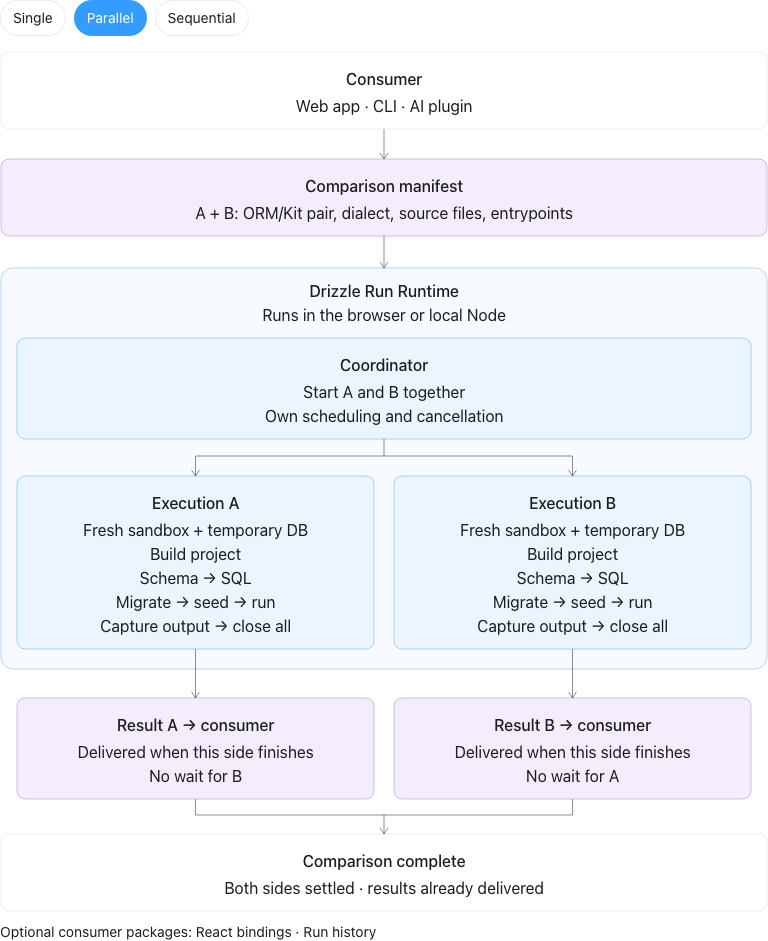

# Architecture

Drizzle Run is a sandbox for executing code that uses Drizzle. A consumer supplies a manifest, the runtime owns
the complete execution lifecycle, and the consumer decides what to do with the output.

The agreed SDK architecture below is the project's architecture contract. Use it when changing responsibilities,
public APIs, or resource ownership. The public browser and Node SDK entries use the QuickJS-WASI integration.

## Agreed SDK architecture

Open the [interactive schema](architecture/runtime.html) in a browser to switch between single, parallel, and
sequential execution. The diagram describes logical ownership. It does not prescribe worker or process placement.

### The manifest is the entry point

The runtime accepts code from any consumer: the Drizzle Run web app, a CLI, an AI plugin, or another application.
The source of the code does not change how it executes. It must conform to the manifest contract.

A single-run manifest contains the Drizzle ORM/Kit release pair, the PostgreSQL or SQLite dialect, project files
as text, and their entrypoints, such as schema, optional seed, and query. A comparison manifest describes two
independent sides, each resolved to its own run manifest.

### The runtime owns execution

The public runtime API supports a single execution or a side-by-side comparison. An internal coordinator creates
and owns the child executions. Consumers do not have to assemble the children or manage their resources.

| Mode       | Scheduling                                                                 |
| ---------- | -------------------------------------------------------------------------- |
| Single     | Create and run one child execution.                                        |
| Parallel   | Run A and B concurrently, with separate sandboxes and databases.           |
| Sequential | Run A, finish its cleanup, then start B with its own sandbox and database. |

Every child owns one manifest, one sandbox, and one temporary database. It handles the complete pipeline:

1. Build the supplied project for sandboxed execution.
2. Evaluate the schema and generate migration SQL with Drizzle Kit for the selected dialect.
3. Apply the migration to the temporary database.
4. Execute the seed and user code.
5. Capture results, errors, and execution output.
6. Close the database, sandbox, and the other live execution resources it owns.

Success, failure, and cancellation all require cleanup. The coordinator propagates cancellation to active
children, prevents pending children from starting, and waits for active children to settle. Every outcome forces teardown of the execution host. Ordinary cleanup failures are internal diagnostics,
visible only with `debug: true`; they cannot replace the execution outcome or skip another resource's teardown.
A failure to terminate the owned host settles as an explicit cleanup failure and refuses further admission;
the result never confirms termination in that case.

Every execution is temporary. User state and database rows never carry into another execution. The agreed
lifecycle also releases live execution hosts and prepared guests after the request, rather than keeping them warm
for a later run. The browser and Node adapters implement the same ownership contract.

### Each side delivers its result independently

A side's settled result becomes available after that side's execution host has been terminated. It does not wait
for the other side. A consumer can display A's result while B is still running, or B's result while A is still
running in parallel mode.

The overall comparison completion is a separate signal. It settles after both sides have reached their terminal
outcomes, including cancellation of a side that never started. It collects the per-side outcomes without delaying
their delivery. A result or error remains associated with the side that produced it.

### Consumers own the experience

The consumer owns its UI, editor, project storage, sharing, and presentation of results. These do not participate
in the runtime's ownership of a sandbox or database.

React bindings and run history are optional packages around the runtime. React bindings simplify integration with
the public contract. History consumes execution results and retains them according to its own policy. Neither is
required to execute a manifest. Single/comparison coordination belongs to the execution SDK, independently of history.

Manifest schemas, the release catalog, and shared result contracts remain separate from execution I/O. Exact
package layout and public method names can be refined within these boundaries.

### Public SDK ownership

`Runtime.createRun` accepts one manifest. `Runtime.createComparison` accepts `{ a, b }` manifests and creates its
own child runtimes. The comparison exposes each side's ordinary run subscriptions and result promise, plus a
separate aggregate result. Its scheduling option selects parallel or sequential execution.

The application's optional orchestration adapter consumes this comparison handle and retains history independently.
Each execution container is temporary. Browser eager preparation can retain immutable assets and snapshots;
on-demand preparation closes the runner after each request. Neither policy retains a live execution container.

## QuickJS integration

The runtime uses QuickJS-WASI directly, with a shared engine and a JavaScript dependency bundle for each exact
Kit/ORM pair. The consumer still submits a manifest. Engine selection does not change ownership: the SDK
coordinates children, and each child owns its complete temporary execution.

### One realm, one temporary database

`manifest → esbuild-wasm → schema → Kit SQL → database bootstrap → seed → query → output → teardown`

Schema, Kit, ORM, approved libraries, seed, and query execute in the same QuickJS realm. The compiler bundles
project modules outside the sandbox and binds approved imports to the dependency instances already loaded
inside it. Schema evaluation happens once; seed and query import that same module identity.

The host owns the database. PostgreSQL uses the real `pg` client inside QuickJS and PGlite's binary wire
protocol outside it. The bridge validates bounded byte requests and serializes exchanges for one client.
The host never evaluates project JavaScript. SQLite uses the official SQLite Wasm package through its
libSQL-compatible guest driver boundary. Browser and Node database workers each use a fresh memory-backed database;
persistent VFS implementations are disabled. SQLite does not require OPFS or native database bindings.

Only protocol bytes, progress, diagnostics, and serialized output cross the boundary. Dates, BigInts, bytes,
undefined values, transaction behavior, and database error codes must survive the boundary.

### Snapshot ownership

The first execution loads dependencies and captures a template before evaluating any project source or
initializing per-run state. It executes the first project in that original VM. Later executions restore the
immutable template into fresh VMs; they never reuse a previous project's VM, database, callbacks, or modules.

Snapshots are captured locally, not shipped as release artifacts. An owner can retain immutable engine bytes,
dependency source, and a private snapshot between runs. Closing that owner releases them. A comparison owns
its children and closes each child before delivering its result.

Snapshot capture refuses host resources such as retained Intl formatters or project modules. Restored VMs
rebind their host callbacks. Randomness and deterministic helpers initialize after capture: an explicit seed
is repeatable, while an omitted seed receives fresh host entropy.

### Machines own the lifecycle

All implementation source, workers, build scripts, and tests use TypeScript. XState machines stay
internal. Their actors receive typed dependencies at the composition root; pure contracts do not import host I/O.

| Owner             | States                                                             | Decisions owned by the machine                                                                                                       |
| ----------------- | ------------------------------------------------------------------ | ------------------------------------------------------------------------------------------------------------------------------------ |
| Runner            | idle, running with acquiring/executing/cleaning children, closed   | Admit one request, refuse concurrent work, route cancellation and deadlines through forced teardown, publish only after termination. |
| Execution         | compile, setup, schema, sql, database, seed, run, cleanup, settled | Invoke each phase in order; any failure enters cleanup; no later execution phase starts after failure.                               |
| PostgreSQL bridge | open with idle/busy children, closed                               | Bound queued requests, serialize protocol exchanges, reject admission after close, settle pending requests.                          |
| Guest transport   | connecting, open, closed                                           | Admit writes only when connected; correlate replies; ignore late replies and queued connection notifications after close.            |
| Comparison        | pending, active, cancelling, settled per side                      | Start each side once; wait for A's teardown before sequential B; cancel pending sides without allocation; publish independently.     |

Cancellation of CPU-bound JavaScript cannot depend on a message handled by the blocked execution thread.
The outer browser worker or Node process owner terminates that execution container. It waits for the host's
termination contract before publishing. Browser termination uses the native Worker API; Node waits for child
process exit. Neither alone proves physical memory reclamation by the operating system.

Cleanup closes database admission, invalidates pending callback ownership, clears timers, disposes the VM,
and attempts database close within a bounded interval. The outer owner then force-terminates the container.
Late database replies must not call into a disposed VM. Observer failures must not interrupt cleanup.

Sequential comparisons deliver A after release and before allocating B. A failure does not suppress B.
Cancelling from A's result observer prevents B from starting. Parallel comparisons deliver whichever side
finishes first; aggregate completion waits for both terminal outcomes.

### Packaging and application integration

The public `/browser` and `/node` factories compose the shared QuickJS runtime controller with platform-specific
runner factories. The application and optional React/history packages consume that same public SDK. Direct
`/quickjs` entries expose the lower-level runner and comparison API.

`scripts/build-quickjs.ts` builds a dependency bundle and export catalog for every pinned guest image and each
dialect. Browser execution and database worker entrypoints are bundled separately. The bundler selects the
published browser and Node SQLite exports for each host. The build copies QuickJS, extension, compiler, PGlite, and SQLite binaries
next to the worker bundles so their relative URLs remain portable.

`scripts/prepare-runtime-assets.ts` hashes the complete QuickJS directory into one immutable
`<digest>/quickjs/` group. Each file also has an individual size and SHA-256 in the generated inventory.
Declaration closures are separate gzip assets with stored and decompressed integrity metadata.
The application's R2 endpoint serves only inventory entries; SDK consumers use `copyRuntimeAssets` to
copy exactly the same tree and supply its public base URL.
The generated manifests are build outputs, cached with their asset files and the emitted SDK in one build task,
because fresh PostgreSQL templates
contain initialization metadata and produce a different content hash on a fresh build.

Build output is first assembled in `.cache/runtime-assets/quickjs`. TypeScript emits SDK modules and declarations;
the final staging step then copies bundled workers into `dist/quickjs`, preventing the compiler from replacing
bundled entrypoints with unbundled source. Both the SDK package and R2 staging receive the current inventory.

### Verification boundaries

Private validation infrastructure lives under `testing/`. Machine path helpers remain independent of core;
shared fixtures depend on core, and capability gates exercise the runtime. Separate workspaces preserve that
dependency direction, while test consumers use development dependencies. None belongs to the shipped SDK.

Changes must preserve every admitted release/dialect and approved module, schema identity, seed/query behavior,
transactions and rollback, structured values, source locations, inspection, query plans, and ordered SDK events.
Lifecycle checks cover success, phase failure, cancellation before allocation and during execution, bounded cleanup,
independent comparison results, and no state carried into the next execution.

The shared execution acceptance suite runs concrete SQL and lifecycle assertions in Node, Chromium, and WebKit.
Package audits check exported declarations, complete immutable assets, and installation outside the checkout.
Passing a build alone does not establish these runtime requirements or physical memory reclamation.
